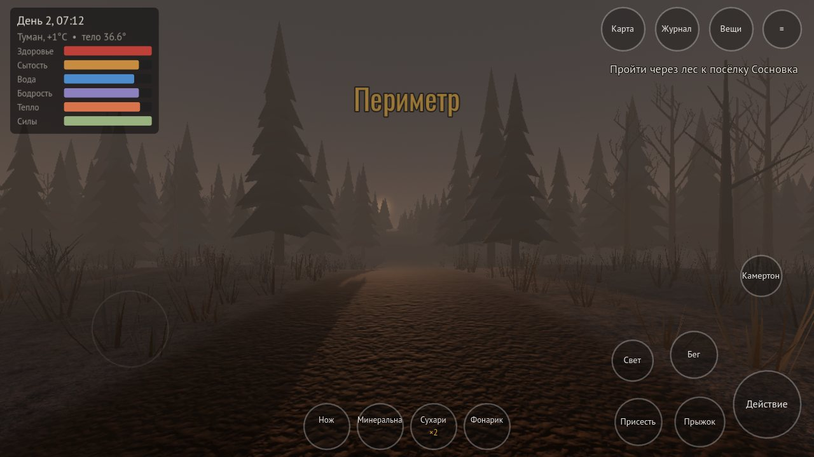
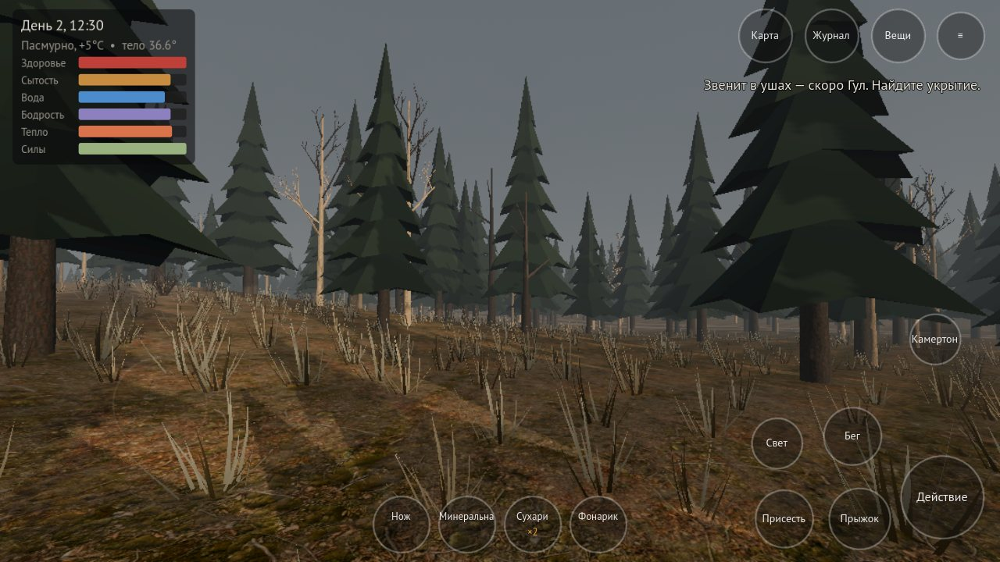
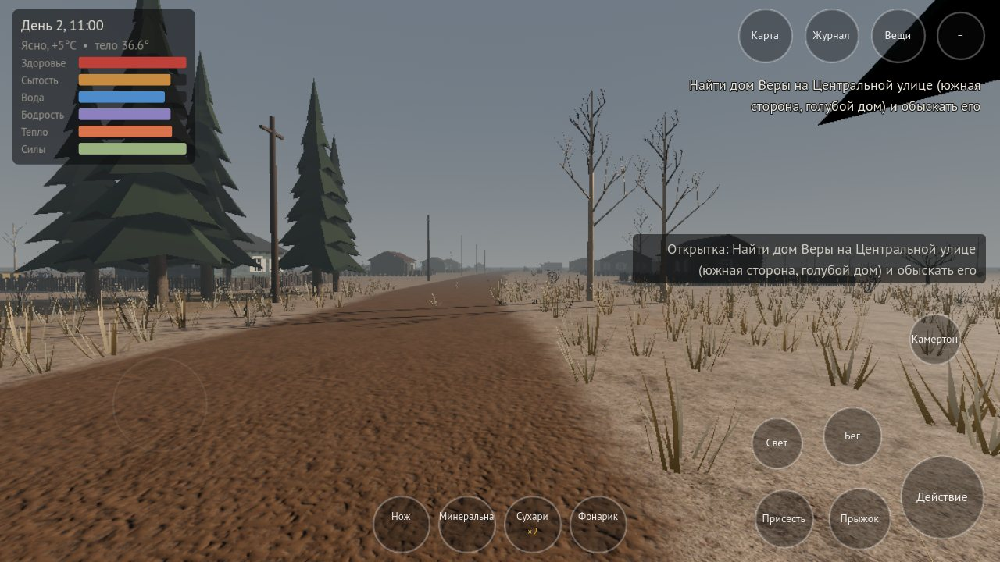
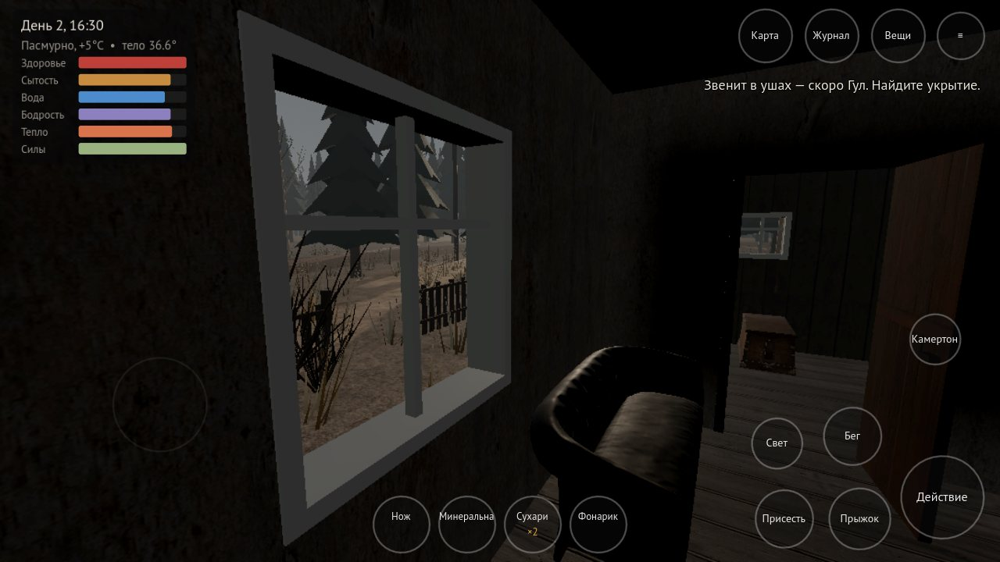
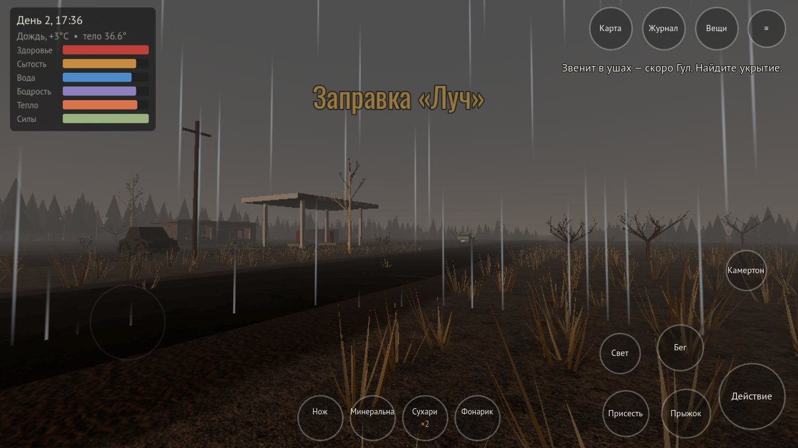
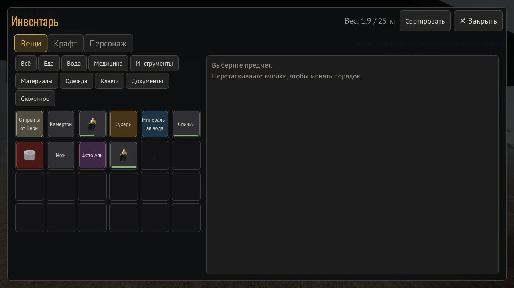

# ZERO ZONE · НУЛЕВАЯ ЗОНА

Атмосферный 3D‑survival от первого лица для Android (и PC). Без зомби: опасность — холод, голод, люди и непонятный **Гул**, который накрывает зону каждые пару дней.

> 3 октября, 03:17. За одну ночь из Каменского района исчезли сорок тысяч человек. Официально — авария на химкомбинате. Через год настройщик фортепиано Глеб Ланской получает открытку от пропавшей сестры: «Не верь им. Мы живы. Ищи под школой».

| | |
|---|---|
|  |  |
|  |  |
|  |  |

## Скачать и установить (Android)

1. Откройте **[Releases](../../releases/latest)** → скачайте `ZeroZone-v….apk`.
2. Откройте файл на телефоне → разрешите установку из этого источника → «Установить».
3. Требования: Android 7+, 64‑битный процессор (arm64). Рекомендуется GPU с Vulkan; на старых устройствах игра автоматически переключается на OpenGL ES 3.

Каждый пуш в `main` автоматически собирает новый APK (вкладка **Actions** → *Build APK & PC*) и публикует релиз. Новые версии ставятся поверх старых, сохранения не теряются.

**PC:** в том же релизе — `ZeroZone-windows.zip` и `ZeroZone-linux.zip`. В настройках выберите «Режим управления → PC».

## Управление

| Действие | Android | PC |
|---|---|---|
| Ходьба | плавающий джойстик (левая половина экрана) | WASD |
| Обзор | свайп по правой половине | мышь |
| Действие (взять, открыть, говорить) | «Действие» | E |
| Бег / присесть | «Бег» / «Присесть» (переключатели) | Shift / C |
| Прыжок | «Прыжок» | Пробел |
| Удар (если в руке оружие) | «Удар» | ЛКМ |
| Фонарик / факел | «Свет» | F |
| Камертон (поиск тайников) | «Камертон» | Q |
| Инвентарь, крафт, персонаж | «Вещи» | Tab / I, K |
| Журнал / карта / радио | «Журнал» / «Карта» | J / M / R |
| Быстрые слоты | нижние кнопки | 1–4 |
| Мел (знак на стене) | из инвентаря | G |
| Пауза, сохранение, настройки | «≡» | Esc |

Все клавиши переназначаются в настройках. Там же — чувствительность, размер и прозрачность кнопок, раскладка для левши, качество графики, разрешение рендера, тени, дальность прорисовки, громкость, сложность и длина суток.

## Что уже есть

- **Мир:** регион ~1,6×1,2 км — периметр с дырой в заборе, лес «Чёрная Грива», ручей Ржавец с мостом, охотничий домик, стоянка туристов, посёлок **Сосновка** (16 домов с интерьерами, ФАП, магазин, школа с бомбоубежищем, гаражи, водонапорная башня, колодцы), трасса Р‑17, заправка «Луч».
- **Выживание:** сытость, вода, бодрость (сон), выносливость, температура тела (погода, ветер, мокрая одежда, утепление, укрытие, огонь), здоровье, кровотечение, отравление сырой водой и грибами. Предупреждения заранее — игрок всегда успевает среагировать.
- **Гул:** периодическая инфразвуковая волна. Глеб (абсолютный слух) слышит её заранее. Укрытие — дом (60%), машина (75%), подпол или убежище (100%), восковые беруши.
- **Инвентарь:** сетка 24 ячейки, вес и перегруз, категории, описание, перетаскивание, разделение стаков, быстрые слоты, одежда по слотам (утепление, защита от дождя), иконки из 3D‑моделей.
- **Сбор и крафт:** логичная добыча по типу мебели (≈180 контейнеров), рубка деревьев, хворост, грибы и брусника (отрастают), вода из колодцев и ручья; 19 рецептов с открытием через записки, людей и навыки; станции «руки / огонь / верстак».
- **Убежище:** ящики, спальник, верстак, костёр, бочка для дождевой воды, баррикада, свеча, лампа. Печи в домах можно топить.
- **Люди:** Тихон Петрович — глухой пасечник с распорядком дня, диалогами, заданиями, бартером и доверием. Мародёры «Шакалы» на заправке: днём спят, ночью патрулируют, видят и слышат шум.
- **Сюжет через исследование:** 17 записок и документов, кассета, радиоэфир, журнал с версиями произошедшего, меловые знаки выживших, тайники под полом (камертон).
- **Транспорт:** заброшенные машины (багажник, бардачок, снятие деталей) и «Нива» почтальона, которую можно починить и вести.
- **Погода и время:** цикл суток, ясно/пасмурно/туман/дождь/гроза/снег, процедурный звук окружения.
- **Сохранения:** 5 слотов + автосохранение (при входе в локации, сне, сворачивании приложения). Сохраняется всё: мир, контейнеры, двери, срубленные деревья, постройки, NPC, задания, карта.

## Технологии

**Godot 4.7.2 (MIT), GDScript.** Мобильный рендерер Vulkan с откатом на GLES3, Jolt Physics, стриминг мира чанками 64 м с LOD, MultiMesh‑растительность, слитая геометрия зданий (единицы draw calls на дом), окклюзия, VRAM‑сжатие ETC2/S3TC. Подробности и обоснование выбора — в **[docs/DESIGN.md](docs/DESIGN.md)**. Лицензии ассетов — в **[docs/ASSETS.md](docs/ASSETS.md)**.

```
autoload/   глобальные сервисы: события, база предметов, состояние, настройки, сохранения, звук, ввод
scripts/    core · player · world · interact · npc · systems · ui
data/       контент в JSON: предметы, рецепты, добыча, записки, задания, диалоги, радио, мир
assets/     CC0‑ассеты, шрифты, звуки, иконки, карта
tools/      генераторы региона, звука, импорта; загрузчик ассетов; рендер иконок
tests/      автотесты (83 проверки) и рендер контрольных скриншотов
```

### Сборка локально

```bash
python3 tools/gen_region.py          # после правки data/region.json или data/world.json
godot --headless --import --path .
godot --headless --path . res://tests/test_runner.tscn     # автотесты
godot --headless --path . --export-release "Android" build/ZeroZone.apk
```

## Дальше по плану

Лагерь Марты у ЛЭП, промзона «Прибой», город Зареченск и «Слышащие», Объект‑0 и финалы; замена процедурных людей на анимированные модели; озвучка радио. См. план производства в [docs/DESIGN.md](docs/DESIGN.md#10-план-производства).
